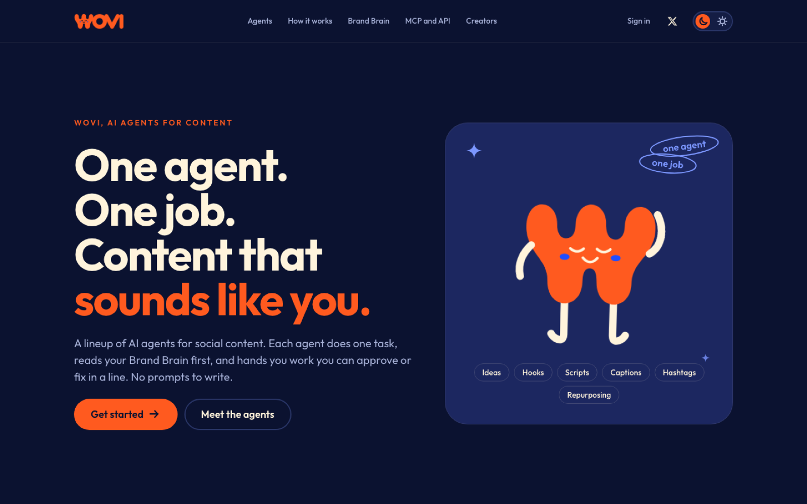
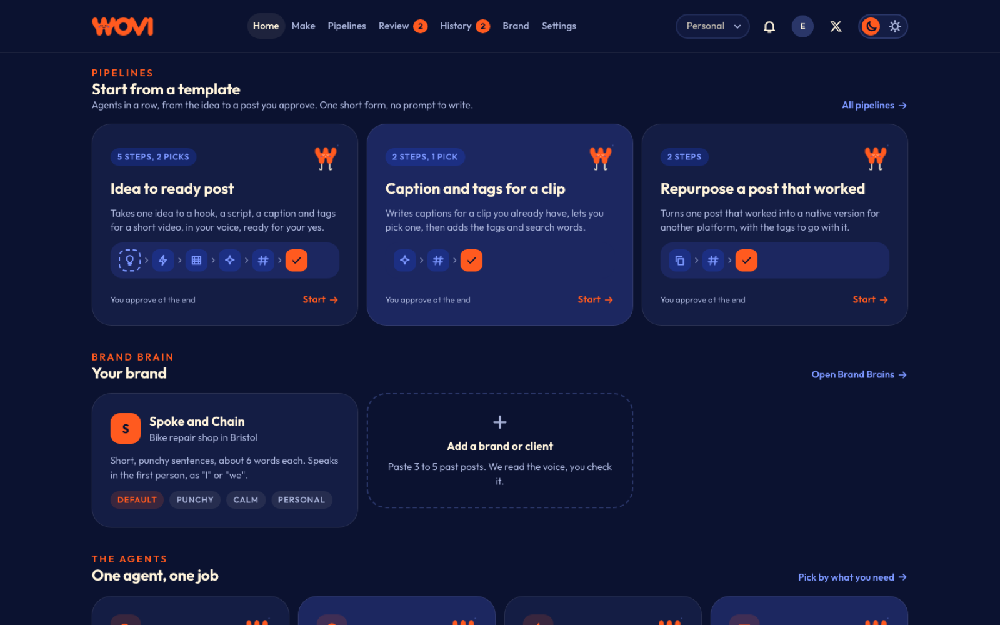
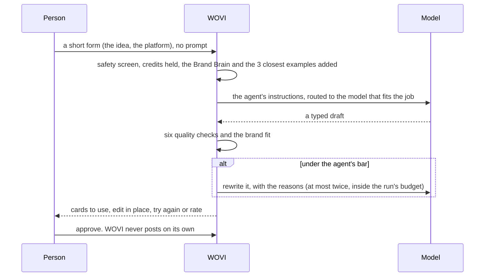
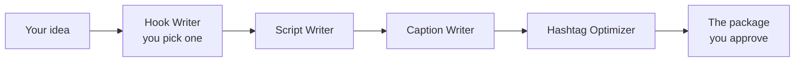
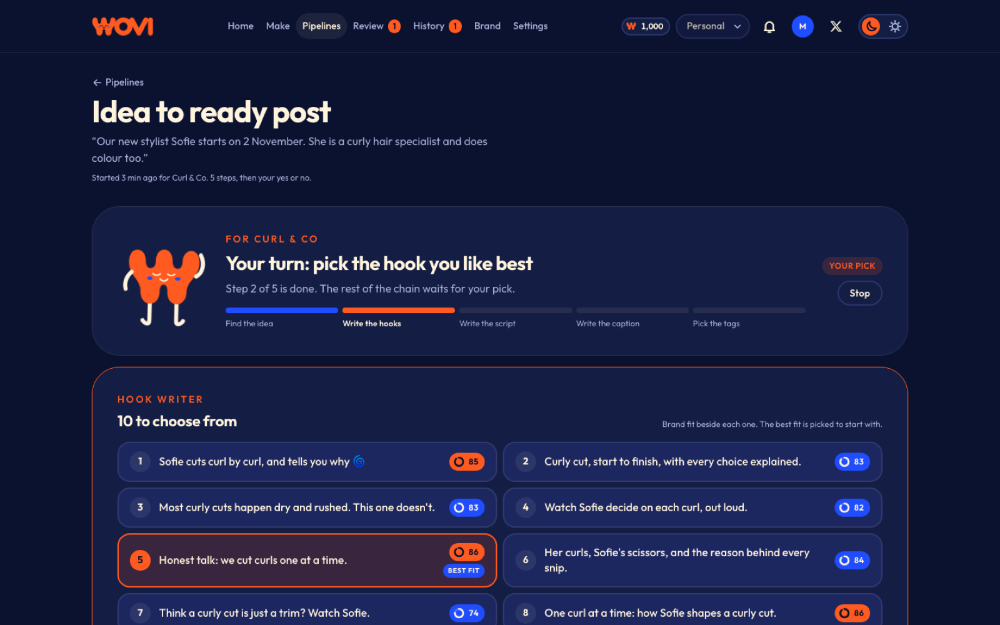
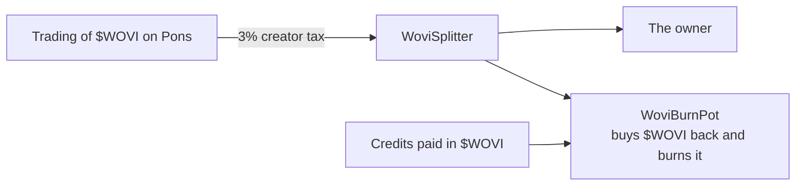

<p align="center">
  
</p>

<p align="center">
  <b>A marketplace of single-purpose AI agents for social content.</b><br>
  You bring the idea. Each agent does one job, in your brand's voice, and you approve what gets posted.
</p>

<p align="center">
  
  
  
  
  
</p>

<p align="center">
  <a href="https://getwovi.fun">getwovi.fun</a> ·
  <a href="https://x.com/wovifun">X</a> ·
  <a href="docs/launch-agents.md">The agents</a> ·
  <a href="docs/brand-brain.md">Brand Brain</a> ·
  <a href="docs/quality.md">Quality</a> ·
  <a href="docs/pipelines.md">Pipelines</a> ·
  <a href="docs/mcp.md">MCP</a> ·
  <a href="docs/api.md">API</a> ·
  <a href="docs/x402.md">x402</a> ·
  <a href="docs/token.md">$WOVI</a>
</p>

---

Most AI tools hand you a blank box and wait for a prompt. WOVI hands you a lineup of narrow agents instead. Each one
does exactly one job (find what is trending, plan the week, write the hook, the script, the caption, the tags, or
turn one post into a version for every platform), so each one can be tuned, scored and priced on that one outcome.

Every agent reads your **Brand Brain** first: your voice, your words, the posts that worked for you, your dos and
don'ts. You fill in a short form, never a prompt. The draft is scored before you see it, rewritten if it falls short,
and nothing is posted by WOVI: a person approves every result.

<p align="center">
  
</p>

## The agents

| Agent | What it does |
|---|---|
| **Trend Scout** | Finds the formats rising in your niche this week, each one tied to a live web finding and its source, and how you could use it |
| **Idea Generator** | A week of post ideas that only your business could post, across formats and your own topics |
| **Hook Writer** | Ten opening lines for a post or a short, across ten different angles, each one a few words long |
| **Script Writer** | One idea turned into a short video script: hook, setup, turn and ending, timed to the second, with what to film |
| **Caption Writer** | Captions to match the clip, for each platform you pick, two different angles each |
| **Hashtag Optimizer** | The few hashtags and search words that help the right people find the post, and where each one goes |
| **Platform Repurposer** | One post that worked, rewritten as a native version for each of your other platforms |

They write for **X, TikTok, YouTube Shorts and Instagram Reels**. Every one of them is a spec (data, not code): the
same spec is the web form, the MCP tool, the REST endpoint and the agent-to-agent call. A new agent works everywhere
without a deploy. See [`docs/agents.md`](docs/agents.md) and [`docs/launch-agents.md`](docs/launch-agents.md).

<p align="center">
  
</p>

## How a run goes



The model is invisible: each agent names a capability tier and the platform routes it, so a model can be swapped
without touching an agent. A failed run costs nothing; the credits held for it come back.

## The Brand Brain

Paste three to five posts that worked for you and WOVI reads them back: how long your sentences run, your emoji and
hashtag habits, the words you come back to, how you open and close. You check it, change anything, and every agent
anchors to it from then on: the voice, the mood board, your best posts as examples, the dos and don'ts, and the idea
behind the brand. One account can hold many Brand Brains, one per brand or client. See
[`docs/brand-brain.md`](docs/brand-brain.md).

## The quality system

Anti-slop is a system, not a promise. Every draft is scored before anyone sees it:

| Check | Weight | What it asks |
|---|---|---|
| Specific to you | 25 | Does it name real details from your input and your Brand Brain? |
| No generic phrases | 20 | None of the stock lines any brand could post |
| Brand fit | 20 | Your voice, your words, none of your words to avoid, every don't kept |
| Like your best posts | 15 | Close in shape to the posts that worked for you |
| No misleading claims | 10 | No promises about health, money or results, no invented reviews |
| Fits the platform | 10 | Inside every limit of the platform it is for |
| Second opinion | 25 | A model judge reads the draft against the agent's rubric (on the test bench) |

Below the agent's bar the draft is rewritten with the reasons, at most twice; if it is still below, a person decides.
Every agent has a **gold test set of 30 curated examples** across ten kinds of business, rerun on every new version,
and a new version cannot go live if it scores below the one it replaces. Live stats on every agent (how often a
result is used, edited or tried again) come from real use, never from claims. See [`docs/quality.md`](docs/quality.md)
and [`docs/stats.md`](docs/stats.md).

## Pipelines

Agents chain into a pipeline, where each step's typed output becomes the next step's input:



Three templates come with WOVI: **Idea to ready post**, **Caption and tags for a clip** and **Repurpose a post that
worked**. A step that fails a brand check is rewritten on its own; any part of the finished package can be edited,
tried again or rated by itself; and any idea from Idea Generator becomes a post in one click. See
[`docs/pipelines.md`](docs/pipelines.md).

<p align="center">
  
</p>

## Use it from Claude, ChatGPT, Cursor or your own software

WOVI is an **MCP server** at `/mcp`, built on the official MCP SDK. An assistant sees exactly the agents and pipelines
its workspace can run, with each form described from its spec, so it fills it in right the first time.

```json
{
  "mcpServers": {
    "wovi": { "url": "https://getwovi.fun/mcp", "headers": { "Authorization": "Bearer wovi_sk_YOUR_KEY" } }
  }
}
```

| Tool | What it does |
|---|---|
| `list_agents` | The agents, their inputs and about what a run costs |
| `run_agent` | Runs one agent and returns the result, or the run id to come back for |
| `get_run` | Status, the typed result, the quality score and reasons, the charge |
| `give_feedback` | What the person did with a result: used it, edited it, tried again, rated it |
| `list_brand_brains` | The workspace's Brand Brains |
| `start_pipeline` · `pick_option` · `get_pipeline` | Run a pipeline, answer its picks, read the package |
| `credits_balance` | Available, held, used this month |

The same calls are a **REST API** under `/api/v1` with an OpenAPI 3.1 document, API keys per workspace, rate limits,
idempotency keys and signed webhooks:

```bash
curl https://getwovi.fun/api/v1/agents/hook-writer/runs \
  -H "Authorization: Bearer wovi_sk_YOUR_KEY" -H "Content-Type: application/json" \
  -d '{"inputs": {"idea": "Our sourdough starter Gerald turns nine on Saturday", "platform": "tiktok"}}'
```

Agents and software that have no account can pay per call with **x402**: the server answers `402` with the price, the
caller pays on Robinhood Chain and sends the request again with the proof. See [`docs/mcp.md`](docs/mcp.md),
[`docs/api.md`](docs/api.md) and [`docs/x402.md`](docs/x402.md).

## Credits

| | |
|---|---|
| One credit | $0.01, a fixed price |
| What a run costs | its real model cost with a margin, in whole credits, shown before it runs |
| The estimate | the most a run can cost; a run never costs more |
| A failed run | costs nothing |
| Paying | a stablecoin or ETH on Robinhood Chain, $WOVI, or x402 per call |
| Limits | an owner can set a monthly limit for the workspace |

See [`docs/credits.md`](docs/credits.md).

## $WOVI



| Contract | What it does |
|---|---|
| `WoviBurnPot` | Launches $WOVI on Pons, once, from the launcher wallet only. Then buys $WOVI with the ETH it holds and burns it with the token's own `burn()`, so the supply falls. At most once every 30 minutes and at most 1% of the market's depth per burn. No withdraw, no owner |
| `WoviSplitter` | Where the trading fees are paid. Splits every fee between the owner and the burn pot, with shares fixed when it is deployed |

The 3% tax, the ETH pair and the fee recipient are forced by the burn pot at launch and read back; a launch that comes
out any other way reverts. The launcher's opening buy happens inside the launch transaction, so nothing can trade
ahead of it. Nothing in either contract can be changed after deploy, except that the owner can hand its own share of
future fees to another address. See [`docs/token.md`](docs/token.md).

## Safety and platform rules

- **Nine kinds of content WOVI does not write:** fake reviews or testimonials, impersonation, deepfakes, false
  claims, hate, harassment, sexual content, unsafe advice and copyrighted music. Requests are screened before any
  credit is held; every draft is checked again.
- **A person approves every result.** WOVI drafts; people publish.
- **Facts only from you.** Agents are told never to invent numbers, prices, dates, results, customers, reviews or
  opening hours, and the checks look for it.
- **Consent.** Real people appear only with their permission, handled by the owner, never written into the post.

See [`docs/safety.md`](docs/safety.md).

## For teams and agencies

Workspaces with roles, a review queue with approval rules, clients with share links for their sign-off, comments,
assignments and notifications. Every record carries a workspace id from day one. See
[`docs/review-and-teams.md`](docs/review-and-teams.md).

## The Agent Builder

Every WOVI agent is made in the same builder: described in a sentence, drafted as a full spec, given gold and bad
examples and a mood board, run on the test bench, scored, tuned in plain words, versioned, released to a share of
traffic first and rolled back in one click. It is internal for now; it is the same tool creators will use to build
their own agents. See [`docs/builder.md`](docs/builder.md).

## What is here

| Folder | What it is |
|---|---|
| [`src/app`](src/app) | The site and the app (Next.js 16): pages, server actions, the REST API, the MCP route |
| [`src/lib/agents`](src/lib/agents) | The agent spec and the registry |
| [`src/lib/runs`](src/lib/runs) | The run engine: queue, prompt, model routing, parsing, guardrails, costs, tools |
| [`src/lib/launch`](src/lib/launch) | The seven agents, their instructions and their gold test sets |
| [`src/lib/brand`](src/lib/brand) | The Brand Brain and the brand-fit check |
| [`src/lib/quality`](src/lib/quality) | The quality gate, the scorecard and the model judge |
| [`src/lib/pipelines`](src/lib/pipelines) | Pipelines and their templates |
| [`src/lib/builder`](src/lib/builder) · [`src/lib/stats`](src/lib/stats) | The Agent Builder, the test bench, live stats and releases |
| [`src/lib/api`](src/lib/api) · [`src/lib/x402`](src/lib/x402) · [`src/lib/webhooks`](src/lib/webhooks) | REST, MCP, pay per call, webhooks |
| [`src/lib/credits`](src/lib/credits) · [`src/lib/chainpay`](src/lib/chainpay) · [`src/lib/token`](src/lib/token) | Credits, payments on Robinhood Chain, $WOVI on the site and the keeper |
| [`src/lib/accounts`](src/lib/accounts) · [`src/lib/team`](src/lib/team) · [`src/lib/safety`](src/lib/safety) | Accounts and passkeys, review and teams, content and platform rules |
| [`contracts`](contracts) | The two $WOVI contracts (Solidity, Foundry) and their tests |
| [`docs`](docs) | One document per part: what it does, where it lives and how it is tested |

## How it is tested

| | |
|---|---|
| The app | 1,017 tests: every agent's form and output shape, the run engine, the quality gate and the judge, pipelines, credits, the API and MCP, x402, safety, accounts and teams |
| The agents | 210 gold examples (30 per agent), each checked against every guardrail with its own Brand Brain; the whole set run on the real models, averaging 92 to 95 per agent |
| The contracts | 89 tests: every rule, invariants under random sequences of calls, and a launch on a copy of Robinhood Chain against the real Pons |
| The screens | A new-user walkthrough on desktop and phone, timed against the product's goals |

    npm ci
    npm test                     # everything, on a fake model: no key, no network, no money
    npx tsc --noEmit -p .
    npx eslint src
    cd contracts && forge test   # the $WOVI contracts

No test calls a real model or touches the real chain.

## Reading it

| | |
|---|---|
| [`docs/launch-agents.md`](docs/launch-agents.md) | The seven agents: what each one does and why, its instructions, its gold set, and every tuning round |
| [`docs/engine.md`](docs/engine.md) | How a run is queued, prompted, routed, parsed, checked and charged |
| [`docs/brand-brain.md`](docs/brand-brain.md) | The Brand Brain and the brand-fit check |
| [`docs/quality.md`](docs/quality.md) | The six checks, the bar, rewrites, the judge and the regression gate |
| [`docs/pipelines.md`](docs/pipelines.md) | Pipelines, templates, picks and the package |
| [`docs/mcp.md`](docs/mcp.md) · [`docs/api.md`](docs/api.md) · [`docs/x402.md`](docs/x402.md) | Use WOVI from an assistant or your own software |
| [`docs/credits.md`](docs/credits.md) · [`docs/token.md`](docs/token.md) | Credits, payments and $WOVI |
| [`docs/safety.md`](docs/safety.md) | What WOVI will not write, and the platform rules |
| [`docs/accounts.md`](docs/accounts.md) · [`docs/review-and-teams.md`](docs/review-and-teams.md) | Accounts, workspaces, review and teams |
| [`docs/builder.md`](docs/builder.md) · [`docs/stats.md`](docs/stats.md) | The Agent Builder, live stats and releases |

## Use it at your own risk

WOVI writes drafts; you decide what to post. $WOVI can lose all of its value. Nothing here is financial advice.
